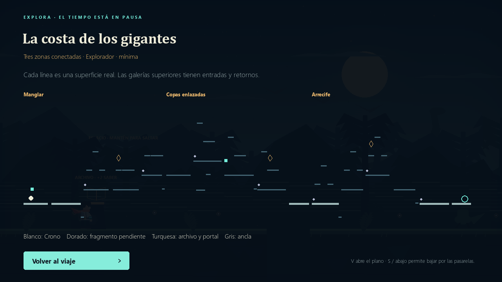
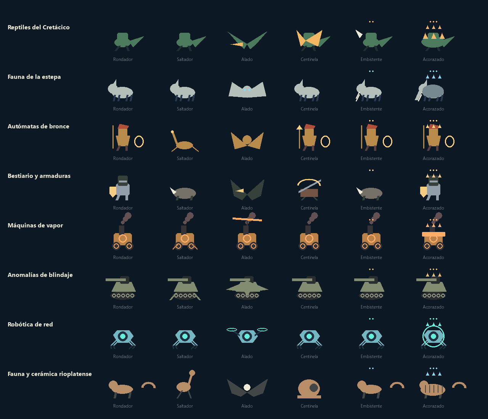
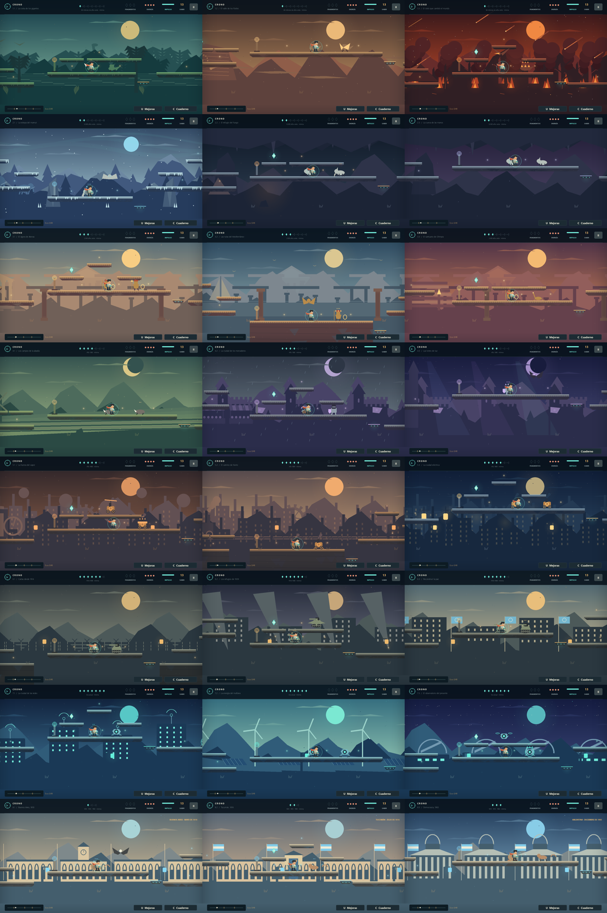

# CRONO · Ecos del tiempo

**Beta educativa 0.5 para Windows.** Plataformas de exploración: Crono atraviesa épocas, recupera su reloj y aprende para volver al presente.

[Descargar beta 0.5](https://github.com/RenzoLeporace/crono-runner/releases/tag/v0.5.0) · [Fuentes educativas](FUENTES.md) · [Verificación](VERIFICACION.md)

## Jugar

Extrae todo `CRONO-Beta-Educativa-0.5-Windows.zip` y abre **CRONO - Ecos del tiempo.exe** o **Jugar.bat**. Conserva **_internal** junto al ejecutable. No necesita Python ni conexión. Los enlaces educativos se abren solo al pulsar su botón.

## Rutas nuevas

Se reemplazaron las plantillas y mapas reflejados por **24 itinerarios propios** de aproximadamente 12.000–15.500 píxeles, frente a 4.550–5.700 anteriores. Hay terrazas a distintas alturas, balcones, galerías inferiores, bifurcaciones y retornos.

Cada mapa tiene tres zonas, tres fragmentos en ramales, **48 ecos**, dos archivos educativos y al menos seis anclas. Las rutas obligatorias no requieren mejoras ni impulso. **V** abre el plano real de superficies, Crono, archivos, anclas, fragmentos y salida. **S / abajo** baja por las pasarelas delgadas.



## Edad y dificultad

El perfil se elige en el menú o en Configuración y cambia preguntas y combate, incluida la partida activa:

| Perfil | Combate |
| --- | --- |
| 6–9 · Explorador | Mínimo: velocidades, resistencia y ventanas amplias de la beta anterior. |
| 10–14 · Aventurero | Más velocidad y resistencia, cargas frecuentes, ataques combinados y marcas de caída en jefes. |
| 15+ · Experto | Salvas de centinelas, alados con disparos apuntados, núcleos abiertos menos tiempo y segunda fase más intensa. |

Las marcas del suelo anticipan proyectiles de caída. Los enemigos que disparan brillan antes de hacerlo; las cargas muestran **!**. Los jefes solo reciben daño con el núcleo dorado. Resolver un archivo de su mapa prolonga la exposición. Cambiar la edad no revive adversarios derrotados.

## Campaña y Argentina

La campaña tiene **21 mapas en siete épocas**. Argentina es una **expansión incluida de tres mapas**, disponible desde el menú, con progreso independiente. Hay ocho jefes finales.

| Época | Mapa 1 | Mapa 2 | Mapa 3 y jefe |
| --- | --- | --- | --- |
| Primigenio | Costa de los gigantes | Valle de los fósiles | Extinción · Guardián del impacto |
| Deshielo | Estepa del mamut | Refugio del fuego | Cueva de las manos · Matriarca de escarcha |
| Grecia | Ágora de Atenas | Rutas del Mediterráneo | Olimpia · Coloso de bronce |
| Medievo | Campos de la abadía | Ciudad de mercaderes | Torres de luz · Vigía de las campanas |
| Industria | Fuerza del vapor | Camino de hierro | Ciudad eléctrica · Titán de vapor |
| Guerras mundiales | Cartas desde 1914 | Refugios de 1939 | Reconstruir la paz · Blindado del olvido |
| Actualidad | Ciudad de las redes | Energía del mañana | Observatorio del presente · Núcleo de la red |
| Argentina · DLC | Buenos Aires, 1810 | Tucumán, 1816 | Democracia, 1983 · Custodio de la memoria |

Las dos guerras mundiales comparten una época: contextos, vida civil y reconstrucción. No se combate contra personas ni poblaciones reales. Los adversarios son anomalías ficticias del reloj; los escenarios son interpretaciones educativas, no reconstrucciones exactas ni una historia universal. Argentina trata tres momentos concretos, no toda su historia.

Las ocho épocas tienen **siluetas propias**, además de seis comportamientos mezclados: patrulla, salto, vuelo, disparo, carga y armadura. Hay reptiles, fauna de estepa, autómatas de bronce, armaduras y ballestas, calderas con ruedas, blindajes con orugas, robots de red y fauna o cerámica rioplatense. Las púas identifican acorazados: evita pisarlos.



Los ambientes incluyen meteoros y cenizas, nieve, cuevas, puertos, lluvia, trenes, trincheras vacías, refugios, redes, renovables, observatorio y arquitectura argentina. Los efectos de fondo no causan daño.



## Aprender y mejorar

Hay **288 preguntas originales**, 96 por perfil, para **48 archivos educativos**. Cada visita sortea una pregunta por edad y mezcla las respuestas; si hay varias, evita repetir inmediatamente la anterior.

Pulsa **E** junto a un archivo para leer y responder. La primera respuesta correcta da dos puntos de conocimiento. Equivocarse explica la respuesta sin restar energía ni puntos. Repasar, cambiar de edad o añadir preguntas al mismo archivo no repite la recompensa.

**U** abre ocho mejoras permanentes: dos aumentos de energía, segundo salto, imán, impulso mejorado, escudo, pulso amplificado y botas. **C** abre el cuaderno con repasos, fuentes y guía de adversarios. Los archivos no son obligatorios para superar rutas ni jefes.

## Docentes

En **Configuración → Ver y editar preguntas** se ven todas las preguntas y respuestas correctas, sin desbloqueos. Hay búsqueda y filtros por época, mapa y edad, incluidos los contenidos nuevos.

**Nueva pregunta**, **Editar** y **Duplicar** permiten elegir mapa, archivo y edad; escribir pregunta, tres opciones, respuesta correcta, explicación y referencia opcional. Guardar aplica el contenido inmediatamente al sorteo. La explicación sirve de pista y devolución.

Los campos admiten tildes, selección, Ctrl+A y Ctrl+C/V. Tab cambia de campo; Ctrl+Enter o Ctrl+S guarda. Las lecturas largas se desplazan con la rueda. Se validan vacíos, opciones repetidas y que cada archivo y edad conserve preguntas. Cancelar o cerrar protege cambios sin guardar.

El banco se guarda en **contenido/preguntas.json**, separado del alumno. Cada modificación de un banco existente crea respaldo en **contenido/respaldos**; también hay **Crear respaldo**. Un viaje nuevo no borra preguntas. Los bancos 0.4 se amplían sin perder modificaciones ni preguntas propias. Para compartirlos copia `contenido` con el juego cerrado. La zona docente no tiene contraseña.

## Controles

| Acción | Teclado | Mando SDL habitual |
| --- | --- | --- |
| Mover | A/D o flechas | Palanca / cruceta |
| Saltar | Espacio / W / arriba | A |
| Bajar por pasarela | S / abajo | Teclado |
| Impulso | Shift / X | X / RB |
| Disparar | F, mantener para repetir | B |
| Archivo educativo | E | Y |
| Plano | V | Desde pausa |
| Taller / cuaderno | U / C | Desde pausa |
| Pausa | Esc / P | Start |
| Volver al ancla | R | Desde pausa |
| Pantalla completa | F11 | — |
| Sonido / captura | M / F12 | — |

Menús con ratón, flechas y Enter; respuestas con 1, 2 y 3. Los botones de mando pueden variar; no se verificó hardware físico.

## Guardado y migración

**saves/progreso.json** usa formato 3. Campaña y Argentina tienen mapa, desbloqueos y ancla independientes; comparten conocimiento, mejoras y cuaderno. Morir conserva aprendizaje y mejoras; un jefe vivo reinicia el combate.

Se importan partidas antiguas con respaldo previo. Al cambiar toda la geometría, una partida 0.4 retoma su mapa desde una entrada segura: conserva fragmentos, ecos, aprendizaje y mejoras, pero no coordenadas de anclas ni enemigos del mapa anterior. Una campaña 0.4 terminada abre las guerras para continuar hasta el nuevo final.

Para trasladar alumnos copia `saves`; para preguntas copia `contenido`. El ZIP no incluye partidas ni bancos personalizados. Nuevo viaje reinicia el progreso de ambas campañas y las mejoras compartidas, pero conserva el banco docente.

## Desarrollo

Python 3.12 en Windows:

```powershell
python -m pip install -r requirements.txt
python Main.py
python tests/test_game.py
python tests/test_education.py
python tests/test_teacher.py
python tests/test_expansion.py
```

Para compilar y empaquetar:

```powershell
python -m pip install -r requirements-build.txt
python tools/build_beta.py
python tools/package_beta.py
```

El empaquetado comprueba ocho pantallas del ejecutable. `python tools/capture_education.py` genera la revisión visual. Ejemplo: `python Main.py --headless --era 8 --map 1 --scene play --camera 600 --capture capturas/argentina.png`. Época 6: guerras; 7: actualidad; 8: Argentina. También hay escenas `atlas`, `boss`, `quiz`, `settings`, `teacher` y `question_edit`.

La simulación usa 120 Hz. Arte y audio se generan por código. `routes.py`: itinerarios; `combat.py`: dificultad; `enemy_art.py`: modelos; `expansion_content.py`: lecciones; `campaign.py`: campañas; `question_bank.py` y `teacher_ui.py`: docentes. El original y la beta 0.2 están en `legacy`. Licencias de terceros en `LICENCIAS.txt` y `licencias`.

Esta beta requiere sesiones humanas de equilibrio y revisión docente; las comprobaciones automáticas no las sustituyen.
