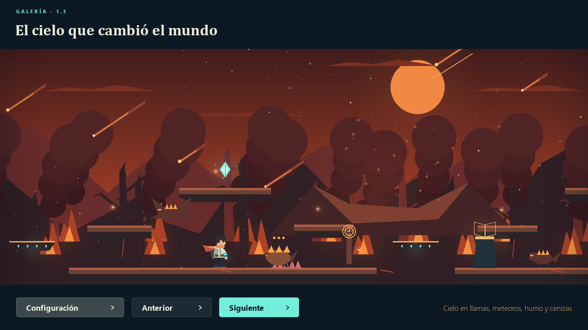
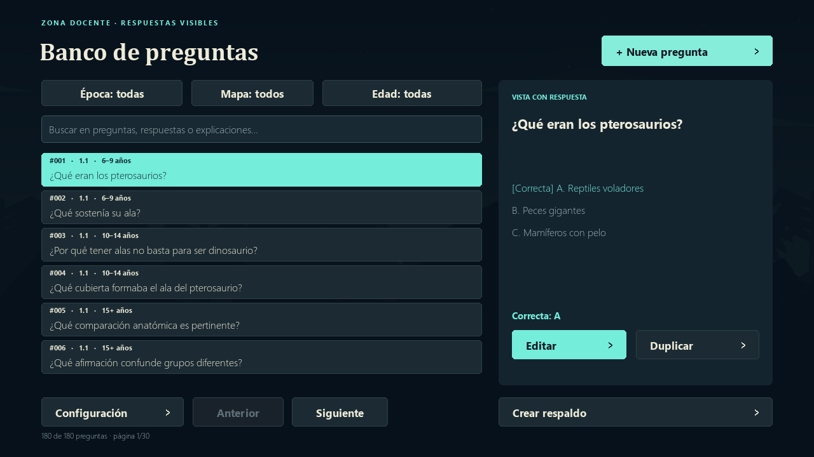
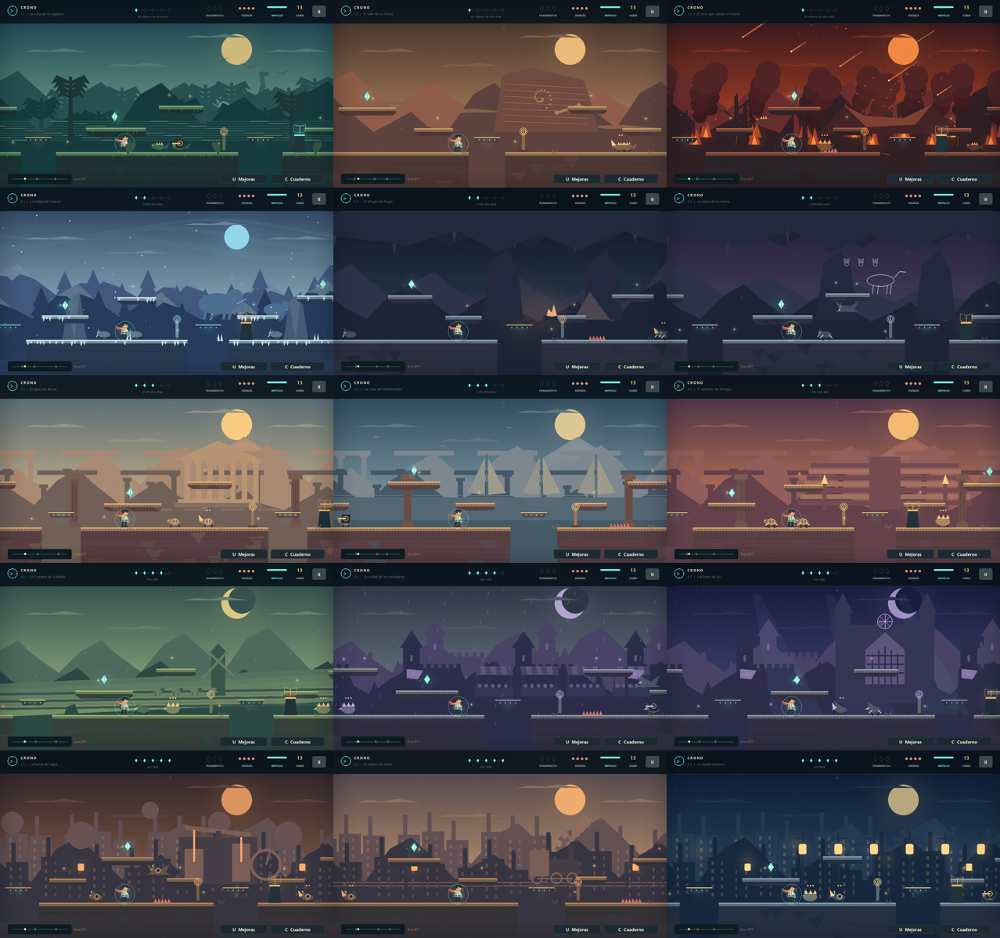

# CRONO · Ecos del tiempo

Beta educativa 0.4 para Windows. Crono debe atravesar cinco épocas, aprender de sus hallazgos y reparar su reloj para volver al presente.



## Descargar la beta

El ejecutable de Windows se distribuye en [Releases · Beta educativa 0.4](https://github.com/RenzoLeporace/crono-runner/releases/tag/v0.4.0). Descarga `CRONO-Beta-Educativa-0.4-Windows.zip` y extrae toda la carpeta. Este repositorio contiene el código fuente; los binarios, las partidas y las preguntas docentes personalizadas no se incluyen en el historial de Git.

## Jugar

Abre **CRONO - Ecos del tiempo.exe** o **Jugar.bat**. No necesita instalar Python ni conexión. Mantén la carpeta **_internal** junto al ejecutable: contiene sus bibliotecas. Para compartir o mover el juego, extrae el ZIP completo. Las fuentes externas del cuaderno se abren únicamente si pulsas su botón.

En el menú puedes elegir **6–9 años**, **10–14 años** o **15 años en adelante**. El perfil se guarda y se puede cambiar sin reiniciar el viaje. Cambian la dificultad de las preguntas y, en el perfil menor, las explicaciones usan un lenguaje más sencillo.

## Aprender y mejorar

El banco inicial tiene **180 preguntas escritas**, 60 por perfil: dos variantes para cada uno de los 30 archivos de campo. Los docentes pueden ampliarlo. Al abrir un archivo se elige una pregunta al azar y se mezclan las respuestas. Si hay más de una pregunta, no se repite inmediatamente la última de ese archivo y perfil.

Acércate a un archivo luminoso y pulsa **E**. Primero lees una explicación, después puedes responder. Resolverlo por primera vez da **2 puntos de conocimiento**. Equivocarse muestra la respuesta con una explicación, permite reintentar y no quita energía ni puntos. Repasar o cambiar de perfil no repite la recompensa de un archivo ya resuelto.

Con **U** abres el taller. Las ocho mejoras permanentes son energía adicional, segundo salto, imán de coleccionables, impulso mejorado, escudo, disparos más potentes, botas rápidas y un segundo aumento de energía. Las dos mejoras de energía permiten llegar a cinco unidades. Hay puntos suficientes para comprar todo mediante el aprendizaje de la campaña.

Con **C** abres el cuaderno: conserva los archivos descubiertos, permite repasar y enlaza las fuentes. Incluye una guía de enemigos y guardianes. Consulta **FUENTES.md** para ver los contenidos y referencias de cada mapa.

## Configuración y zona docente

Entra en **Configuración → Ver y editar preguntas**, desde el menú o desde la pausa. Se pueden consultar todas las preguntas y sus tres respuestas, con la correcta señalada, sin desbloquear mapas. Hay búsqueda por texto y filtros de época, mapa y edad.

Usa **Nueva pregunta**, **Editar** o **Duplicar**. El formulario permite elegir el mapa, uno de sus dos archivos educativos y el perfil de edad; escribir la pregunta, tres opciones, la respuesta correcta, una explicación y una referencia opcional. **Guardar pregunta** aplica el cambio inmediatamente al sorteo de preguntas de ese archivo y edad. La explicación se muestra como pista y al revisar la respuesta. No da una recompensa adicional si el alumno ya resolvió ese archivo.

Los campos admiten tildes, selección, Ctrl+A, Ctrl+C/V y desplazamiento. Tab cambia de campo; Ctrl+Enter o Ctrl+S guarda. Los textos largos se desplazan con la rueda en las preguntas y respuestas. Se validan campos vacíos, opciones repetidas y que cada archivo y edad conserve preguntas. Cancelar o cerrar con cambios ofrece seguir editando o descartarlos.

El banco personalizado se crea al guardar por primera vez en **contenido/preguntas.json**, separado de la partida. Cada modificación de un banco ya guardado crea una copia previa en **contenido/respaldos**; también existe el botón **Crear respaldo**. Un viaje nuevo no borra el banco. Para compartir las preguntas de una escuela, copia `contenido/preguntas.json` junto con el juego. No edites ese archivo mientras el juego esté abierto. La zona docente es de acceso libre y no tiene contraseña.

En **Configuración → Ver los 15 escenarios** puedes recorrer una galería de los ambientes sin alterar el progreso.



## Quince mapas y cinco jefes

| Época | Mapa 1 | Mapa 2 | Mapa 3 y guardián |
| --- | --- | --- | --- |
| Mundo primigenio | Costa: reptiles y aves | Valle de fósiles | Impacto y extinción: guardián del impacto |
| Deshielo | Estepa del mamut | Refugio del fuego | Arte rupestre: matriarca de escarcha |
| Grecia clásica | Ágora de Atenas | Rutas del Mediterráneo | Olimpia: coloso de bronce |
| Medievo europeo | Campos de la abadía | Ciudad de mercaderes | Arquitectura gótica: vigía de las campanas |
| Industria | Fuerza del vapor | Camino de hierro | Electricidad: titán de vapor |

Cada mapa tiene tres fragmentos obligatorios, 17 ecos opcionales, dos archivos educativos y puntos de control. Las rutas y los elementos visuales cambian. En el tercer mapa hay un ancla adicional y una arena de jefe. Para pasar de época debes reunir sus fragmentos y vencer al guardián.

Los 15 mapas tienen ambientes propios: costa con oleaje, cañón polvoriento, extinción con meteoros, incendios, humo y ceniza; estepa nevada, refugio cálido y cueva rupestre; ágora, puerto y Olimpia al atardecer; campos con viento, mercado lluvioso y catedral nocturna; vapor industrial, tren en movimiento y ciudad eléctrica. Son efectos de fondo y no añaden obstáculos invisibles.



Cada jefe tiene un patrón diferente: onda de choque, embestida, ráfaga de proyectiles, picado o descargas de vapor. **Ataca cuando el núcleo se vuelve dorado**. Resolver un archivo del mapa del jefe prolonga su vulnerabilidad. Se pueden superar todos con el equipo básico.

Los enemigos combinan seis comportamientos: rondadores que patrullan, saltadores, alados que oscilan, centinelas que disparan, embistentes que avisan antes de cargar y acorazados resistentes a tres impactos. Los acorazados tienen púas: evita saltar sobre ellos. El disparo temporal sirve contra todos; el impulso también causa daño.

Los enemigos y los jefes son ficción del reloj roto. Los contenidos históricos y científicos se presentan en los archivos con sus fuentes. Los escenarios y sus fechas son orientativos, y cada tema tiene un alcance geográfico concreto.

## Controles

| Acción | Teclado | Mando SDL habitual |
| --- | --- | --- |
| Mover | A/D o flechas | Palanca o cruceta |
| Saltar | Espacio, W o arriba | A |
| Impulso temporal | Shift o X | X o RB |
| Disparo temporal | F; mantener para repetir | B |
| Leer archivo cercano | E | Y |
| Taller / cuaderno | U / C | Desde pausa |
| Pausa | Esc o P | Start |
| Volver al ancla | R | Desde pausa |
| Pantalla completa | F11 | — |
| Sonido | M | Desde pausa |
| Captura | F12 | — |

Los menús admiten ratón, flechas y Enter. Puedes responder con 1, 2 o 3. Los botones de mando pueden variar por controlador; no se verificó hardware físico.

## Guardado y actualización

El progreso, el perfil, el conocimiento y las mejoras se guardan en `saves/progreso.json`. Al continuar reapareces en el último ancla. Se conservan los coleccionables y enemigos derrotados. Morir conserva el aprendizaje y las mejoras; un jefe vivo recupera su energía para permitir otro intento.

La beta 0.4 conserva el formato de partida de la 0.3. También importa las partidas de la 0.2 a su primer mapa de la época correspondiente y conserva fragmentos, ecos y anclas. Antes de escribir el formato nuevo guarda una copia en `saves/progreso-v1-respaldo.json`. Para trasladar la partida a otra carpeta, lleva junto al ejecutable la carpeta `saves`; para trasladar las preguntas personalizadas, lleva `contenido`.

## Desarrollo

```powershell
python -m pip install -r requirements.txt
python Main.py
python tests/test_game.py
python tests/test_education.py
python tests/test_teacher.py
```

La simulación usa pasos fijos a 120 Hz y el render mantiene proporciones al redimensionar. El arte y el audio se generan por código. El contenido inicial y las mejoras están en `crono/education.py`; el banco editable, en `question_bank.py`; el editor, en `teacher_ui.py`; los ambientes, en `visuals.py`; los mapas, en `levels.py`; el combate, en `combat.py`; los paneles educativos, en `learning_ui.py`.

Para construir la beta en Windows con Python 3.12:

```powershell
python -m pip install -r requirements-build.txt
python tools/build_beta.py
python tools/package_beta.py
```

El último comando comprueba seis pantallas desde el ejecutable y crea el ZIP sin partidas ni bancos personalizados. Los avisos de componentes de terceros están en `LICENCIAS.txt` y `licencias/`.

Para capturas: `python Main.py --headless --era 3 --map 2 --scene play --camera 600 --capture capturas/puerto.png`. También se pueden capturar `quiz`, `workshop`, `notebook`, `bestiary`, `boss`, `settings`, `teacher`, `question_edit` y `scenarios`. `python tools/capture_education.py` genera la galería de comprobación visual.

El prototipo original permanece en `legacy/Main_original.py`, y el código de la beta 0.2 en `legacy/beta-0.2`. Los sprites iniciales permanecen como referencia. Esta es una beta jugable: el equilibrio y la adecuación pedagógica aún requieren sesiones con jugadores y revisión docente. No incluye voces ni evaluación escolar certificada.
