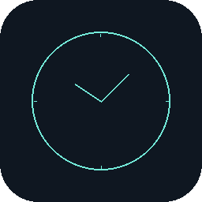
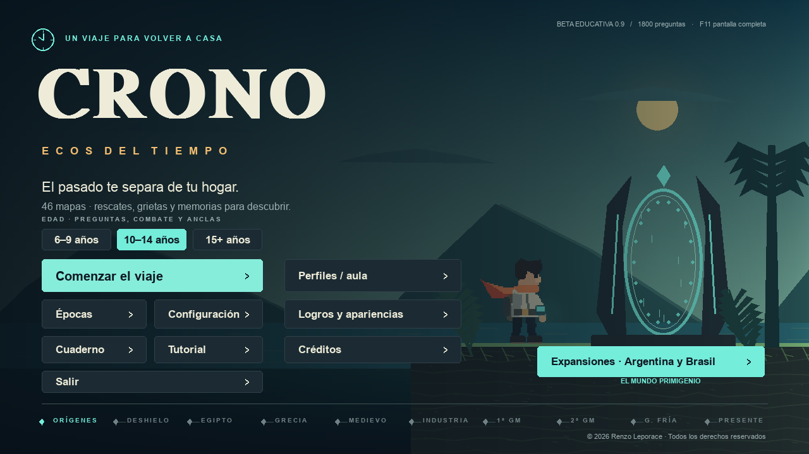
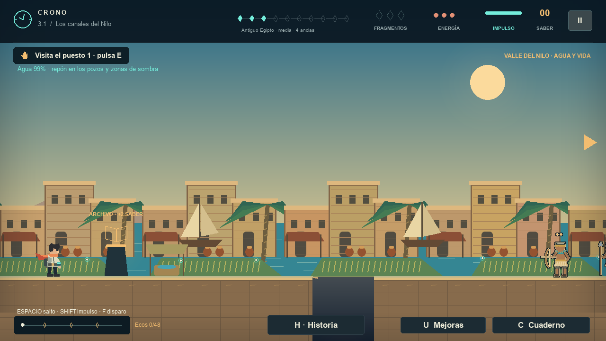
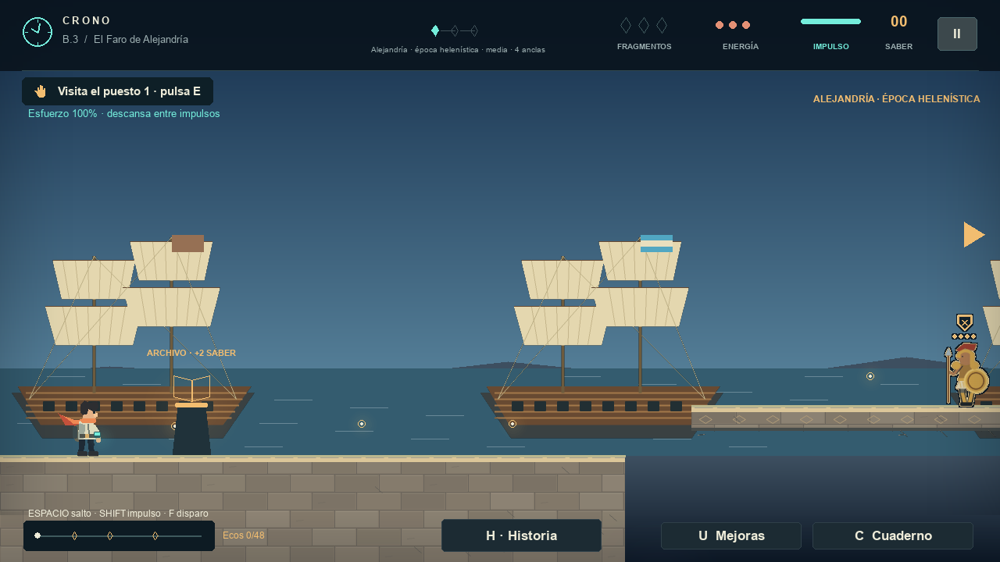
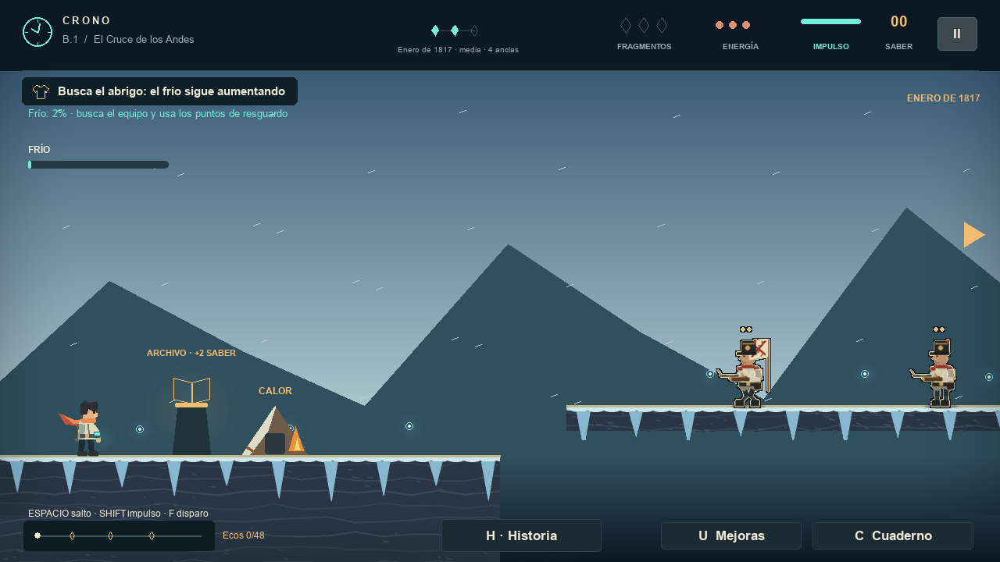
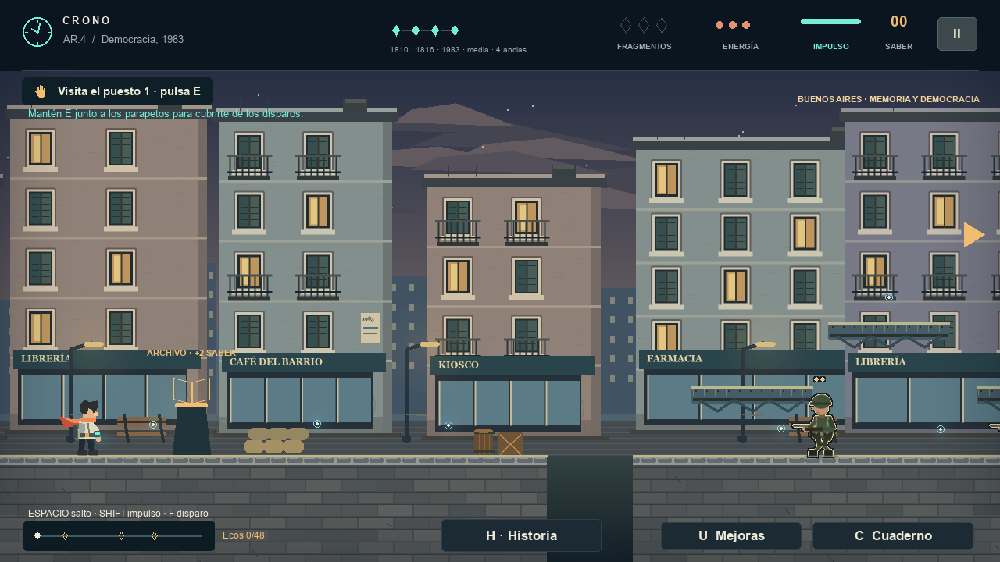
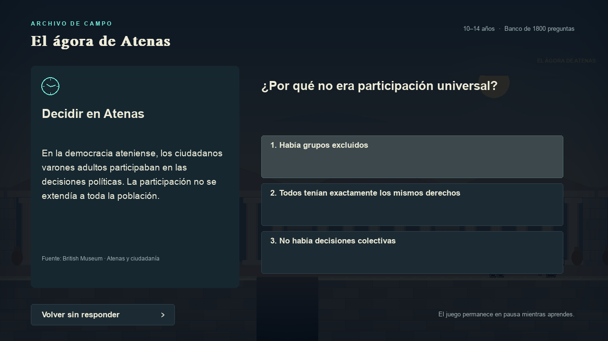
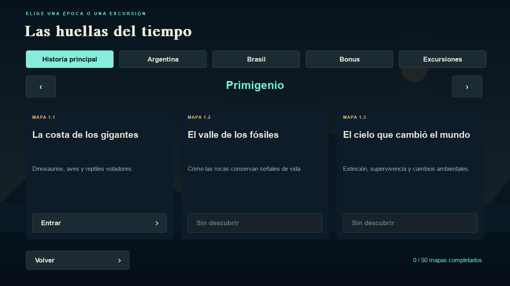
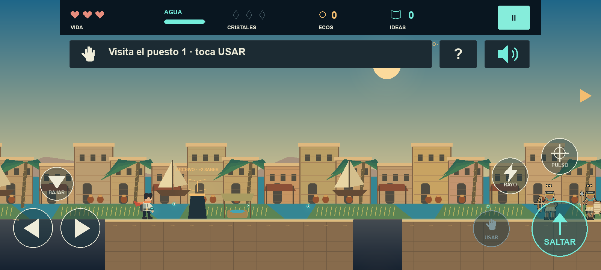

<div align="center">



# CRONO · Ecos del tiempo

**Un juego educativo de plataformas en 2D para viajar por la historia.**
Explorá diez épocas, completá misiones y resolvé archivos con preguntas adaptadas a cada edad.


[Descargar](#descargar-y-jugar) · [Capturas](#capturas) · [Para docentes](#para-docentes) · [Desarrollo](#desarrollo) · [Cambios](CHANGELOG.md)



</div>

---

## Índice

- [Sobre el juego](#sobre-el-juego)
- [Capturas](#capturas)
- [Características](#características)
- [Épocas y campaña](#épocas-y-campaña)
- [Mecánicas de época](#mecánicas-de-época)
- [Aprender, mejorar y personalizar](#aprender-mejorar-y-personalizar)
- [Para docentes](#para-docentes)
- [Descargar y jugar](#descargar-y-jugar)
- [Controles](#controles)
- [Desarrollo](#desarrollo)
- [Documentación](#documentación)
- [Créditos y licencia](#créditos-y-licencia)

---

## Sobre el juego

Para volver al presente, Crono tiene que atravesar épocas históricas: desde el
Primigenio y el antiguo Egipto hasta las guerras mundiales, la carrera espacial y la
Argentina de 1983. En cada mapa explora, cumple una misión inspirada en la época y abre
archivos con lecturas y preguntas sobre lo que aprendió.

Está pensado para el aula y para jugar en casa: funciona **sin conexión**, adapta las
preguntas a tres franjas de edad y permite que cada docente edite, seleccione y traduzca
los contenidos.

> **Estado:** beta educativa. La última publicación es la
> [0.9.2](https://github.com/RenzoLeporace/crono-runner/releases); la **0.9.3** está en
> desarrollo en `main`.

## Capturas

<table>
  <tr>
    <td></td>
    <td></td>
  </tr>
  <tr>
    <td align="center"><b>Egipto</b> · el agua se agota en el trayecto</td>
    <td align="center"><b>Alejandría</b> · bonus del juego base</td>
  </tr>
  <tr>
    <td></td>
    <td></td>
  </tr>
  <tr>
    <td align="center"><b>Cruce de los Andes</b> · frío, abrigo y refugios</td>
    <td align="center"><b>Argentina, 1983</b> · recuperación democrática</td>
  </tr>
  <tr>
    <td></td>
    <td></td>
  </tr>
  <tr>
    <td align="center"><b>Archivos</b> · lectura y pregunta por edad</td>
    <td align="center"><b>Épocas</b> · campaña, países, bonus y excursiones</td>
  </tr>
</table>

<p align="center">
  <br>
  <b>Android</b> · controles táctiles grandes, una sola tarea a la vez y lectura en voz alta
</p>

## Características

| | |
| --- | --- |
| 🗺️ **50 mapas** | Diez épocas principales, rutas de Argentina y Brasil, bonus y excursiones |
| 📚 **1800 registros de preguntas** | 100 archivos y tres franjas de edad (6–9, 10–14, 15+) |
| 🧭 **Una tarea a la vez** | Guía en el mapa con señal de destino, en PC y Android |
| 🌎 **Dos idiomas sin conexión** | Español y portugués de Brasil, con traducciones docentes propias |
| 👕 **19 apariencias y 13 mejoras** | Skins con fichas históricas y habilidades que se compran con lo aprendido |
| 🏆 **60 logros** | Con premio final y rankings locales de clase e institución |
| 🏫 **Salas docentes** | Partidas compartidas en la red local, entre Windows y Android |
| 🎵 **Música original** | Nueve composiciones y 17 efectos de sonido |

## Épocas y campaña

Hay **50 mapas**: 30 de campaña principal, cuatro rutas principales argentinas, tres
bonus argentinos, la Guerra de los Farrapos en Brasil, ocho bonus del juego base y cuatro
grietas históricas. Además hay tres travesías marítimas que vuelven a su mapa de origen.

Las diez épocas principales son **Primigenio, Deshielo, Egipto, Grecia, Medievo,
Industria, Primera Guerra Mundial, Segunda Guerra Mundial, Guerra Fría y Actualidad**.

- **Argentina:** 1810, 1816, Obligado y la recuperación democrática. San Martín abre los
  Andes y Brown su ruta naval. Güemes se habilita al completar 1816.
- **Brasil:** la Guerra de los Farrapos, 1835–1845.
- **Bonus del juego base:** Alejandría, Maguncia, Siracusa, Tombuctú y Bletchley Park, que
  se abren con rescates ficticios en otros mapas.
- **Guerras mundiales:** 1914, Verdún y el armisticio; el Blitz, Stalingrado y Berlín; y la
  excursión química de Ypres.
- **Guerra Fría:** Berlín, el diálogo de 1989–1991 y la Luna, un desafío sin enemigos con
  gravedad reducida, cráteres y la reparación del módulo.

Cada mapa tiene 48 ecos, dos archivos, tres fragmentos, una curiosidad y un trabajo de
campo: transportar provisiones, ordenar un catálogo, imprimir una página, accionar
palancas, acompañar una custodia o leer señales en el momento justo.

## Mecánicas de época

| Época | Efecto en el juego |
| --- | --- |
| Primigenio | El barro frena la marcha; saltar y usar pasarelas ayuda. |
| Deshielo | El frío llena una barra. El abrigo ralentiza la pérdida de calor y las hogueras y refugios la recuperan. |
| Egipto | El agua se agota en el trayecto; pozos y sombra la reponen. |
| Grecia | Los impulsos consumen esfuerzo; el descanso lo recupera. |
| Medievo | La lámpara amplía la zona iluminada y se recarga junto a los faroles. |
| Industria | Rejillas anunciadas expulsan vapor: hay que esperar o rodearlas. |
| Guerras | Las alarmas anticipan impactos; hay que buscar los refugios marcados. |
| Guerra Fría | Sincronización de antenas; en la Luna, baja gravedad y aterrizajes de precisión. |
| Actualidad | Las placas energéticas recargan el impulso incluso en el aire. |
| Argentina y Brasil | Mantener E junto a parapetos da cobertura; cada misión suma logística y comunicaciones. |

Son reglas de juego contextualizadas, no simulaciones históricas ni físicas exactas.

## Aprender, mejorar y personalizar

- **Preguntas por edad** con respuestas mezcladas y explicaciones. Equivocarse da pistas,
  no castigos.
- El banco tiene **1800 registros** con reutilización entre edades, unos 600 enunciados
  distintos. La franja menor no recibe el vocabulario avanzado.
- Una **curiosidad** leída en el mapa vuelve como pregunta en el segundo archivo.
- Las primeras respuestas dan **saber** para comprar **13 mejoras**; la misión y los
  archivos también suman puntuación y premios.
- Los **ecos** compran **19 apariencias** con fichas que explican su contexto histórico.
  Las comprables se habilitan al completar su mapa.
- **Accesibilidad:** asistencia motriz independiente de las preguntas, tamaño de lectura
  ajustable y lectura en voz alta en Android.

## Para docentes

**Configuración → Zona docente** permite ver, añadir, editar, duplicar, importar,
exportar y seleccionar preguntas. Las ediciones se conservan cuando el juego agrega temas
nuevos, y cada pregunta puede tener su propia traducción al portugués.

- Perfiles con alias, clase e institución, y PIN docente opcional.
- Exportación CSV de respuestas y justificaciones.
- Rankings locales de clase e institución.
- **Salas en red local:** el docente aloja la sala desde Windows y los dispositivos se unen
  con IP, puerto y código. Usa HTTP en una red de confianza, sin ranking global.
- **Práctica docente:** recorre mapas, habilidades y apariencias sin gastar monedas ni
  alterar los rankings.

Guía completa: [docs/GUIA-DOCENTE.md](docs/GUIA-DOCENTE.md).

## Descargar y jugar

Las versiones publicadas están en **[Releases](https://github.com/RenzoLeporace/crono-runner/releases)**.

| Plataforma | Cómo jugar |
| --- | --- |
| **Windows** | Extraé el ZIP completo y abrí `CRONO - Ecos del tiempo.exe`, con la carpeta `_internal` a su lado. |
| **Android** | Instalá el APK (Android 8 o posterior) y jugá en horizontal. Para actualizar, instalalo encima de la versión anterior y se conservan los datos. |

El juego incluye su motor y sus recursos: no necesita Internet para jugar. Los enlaces a
fuentes solo se abren si los elegís.

### Desde el código fuente

```sh
git clone https://github.com/RenzoLeporace/crono-runner.git
cd crono-runner
python -m pip install -r requirements.txt
python Main.py
```

En Windows también podés abrir `Jugar.bat`.

**Idioma:** Configuración → Idioma permite elegir **Español** o **Português (Brasil)**.
Más detalles en [docs/IDIOMAS.md](docs/IDIOMAS.md).

## Controles

| Acción | PC | Android |
| --- | --- | --- |
| Moverse | A / D o flechas | Flechas en pantalla |
| Saltar | Espacio | SALTAR |
| Impulso | Shift | RAYO |
| Disparar | F | PULSO |
| Abrir libros y puestos | Pulsar E | Tocar USAR o la señal |
| Trabajar, cubrirse, reparar | Mantener E | Mantener USAR |
| Bajar por pasarelas | S o flecha abajo | BAJAR |
| Historia y objetivos | H | ? |
| Mejoras / Cuaderno | U / C | Desde la pausa |
| Pausa | Esc | II |

Las teclas se pueden reasignar en Configuración, y la guía del mapa muestra la tecla elegida.

## Desarrollo

### Estructura del proyecto

```text
crono-runner/
├── Main.py              # punto de entrada para PC
├── crono/               # código del juego (78 módulos)
│   ├── game.py          # bucle principal, estados y HUD
│   ├── physics.py       # movimiento, colisiones y controles
│   ├── levels.py        # rutas y mapas
│   ├── education.py     # lecciones, archivos y fuentes
│   ├── question_bank.py # banco de preguntas y ediciones docentes
│   ├── i18n.py          # traducciones sin conexión
│   └── ...
├── android/             # entrada y proyecto Android
├── assets/              # audio y catálogo de idiomas
├── contenido/           # banco de preguntas local del docente
├── tests/               # pruebas automáticas y mediciones de rendimiento
├── tools/               # compilación, empaquetado y utilidades
└── docs/                # guías, hoja de ruta e imágenes
```

### Pruebas

```sh
python -m unittest discover -s tests
```

La suite tiene **210 pruebas**: recorre los 50 mapas con física real y cubre misiones,
configuración, guardado, migraciones del banco, idiomas, salas LAN y regresiones de render.
Las mediciones de rendimiento se reproducen con `tests/render_stress.py` y
`tests/boss_stress.py`.

### Compilación

| Destino | Comandos |
| --- | --- |
| Windows | `tools/build_beta.py` y `tools/package_beta.py` |
| Android | `tools/prepare_android.py` y `tools/build_android.py` (SDK 34, JDK 17) |
| Entrega | `tools/create_delivery.py` (carpetas Proyecto, Windows y APK) |

El estado del desarrollo y los próximos pasos están en la
[hoja de ruta](docs/HOJA-DE-RUTA.md).

## Documentación

| Documento | Contenido |
| --- | --- |
| [CHANGELOG.md](CHANGELOG.md) | Cambios de cada versión, con mediciones de rendimiento |
| [docs/GUIA-DOCENTE.md](docs/GUIA-DOCENTE.md) | Zona docente, perfiles y salas |
| [docs/IDIOMAS.md](docs/IDIOMAS.md) | Idiomas y traducciones docentes |
| [FUENTES.md](FUENTES.md) | Fuentes históricas por tema |
| [docs/FUENTES-HISTORIAS-2026-10-27.md](docs/FUENTES-HISTORIAS-2026-10-27.md) | Revisión de las guerras mundiales y Chernóbil |
| [docs/HOJA-DE-RUTA.md](docs/HOJA-DE-RUTA.md) | Estado actual y próximos pasos |

## Créditos y licencia

Creado por **[Renzo Leporace](https://github.com/RenzoLeporace)**, con aportes de
**[Federico Viceconte](https://github.com/federicoviceconte5-jpg)**.

La representación visual es original e ilustrativa, y las misiones no sustituyen a las
fuentes históricas. © 2026 Renzo Leporace. Todos los derechos reservados: ver
[COPYRIGHT.txt](COPYRIGHT.txt). Las licencias de terceros están en
[LICENCIAS.txt](LICENCIAS.txt) y en la carpeta [licencias](licencias/).
